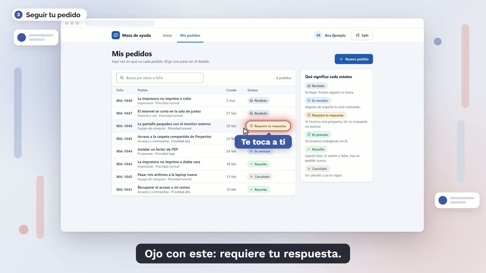

# Video tutorial

Una skill de Claude Code que convierte una herramienta web en un video tutorial narrado. Graba tu herramienta de verdad, sobre una copia con datos de ejemplo, y una voz en español explica cada paso mientras lo que nombra se señala en pantalla.

- **La imagen es la herramienta real**, grabada con Chrome: un cursor que se mueve como el de una persona, tecleo y clics de verdad.
- **La voz manda el ritmo.** Una voz neuronal en español narra, y cada señal (halo, recuadro, flecha, acercamiento) cae justo cuando la voz nombra la cosa.
- **Se ve vivo**: la herramienta va dentro de una ventana, con capas que se mueven a distinta velocidad (parallax), una cámara que nunca se congela, subtítulos y rótulos de capítulo.
- **Un video por audiencia.** El tutorial se hace una vez y cada audiencia tiene su propia entrada de unos segundos. Salen tantos MP4 como audiencias, todos de la misma duración.
- **Al final**, una tarjeta con a quién escribirle si hay dudas y un cierre con tu logo.
- **Revisado midiendo**: que cada señal caiga sobre su elemento, que los subtítulos se lean, que no se oiga la unión entre la entrada y el tutorial, que ninguna palabra prohibida salga en pantalla, el volumen y la duración.

## Ejemplo

[](ejemplo/mesa-de-ayuda-general.mp4)

Mira el video que sale del ejemplo que trae la skill: [`ejemplo/mesa-de-ayuda-general.mp4`](ejemplo/mesa-de-ayuda-general.mp4) (1 min 25 s, 6.4 MB; descárgalo y ábrelo). Enseña a usar una «Mesa de ayuda» inventada: entrar, pedir algo con un calendario que explica por qué un día no se puede, el folio, los estatus y cómo contestar una pregunta. El original sale en 1080p; este es la versión ligera, en 720p.

Para hacer uno así, le pides a Claude:

> Hazme un video tutorial de nuestra mesa de ayuda. Hay una copia de prueba en http://127.0.0.1:8810. Una versión para todo el equipo y otra para Ventas.

Claude te pregunta lo que falta, escribe el guion, graba, arma, revisa y te entrega un MP4 por audiencia:

```
out/mesa-de-ayuda-general.mp4
out/mesa-de-ayuda-ventas.mp4
```

La skill trae esa «Mesa de ayuda» como app de ejemplo, con datos inventados, y el proyecto completo de este video. Para probar todo antes de grabar tu herramienta, pídele a Claude «haz el video de ejemplo de la skill de video tutorial», o hazlo tú desde una copia de este repositorio:

```
node plugins/video-tutorial/skills/video-tutorial/scripts/nuevo.mjs ../video-de-ejemplo --ejemplo
cd ../video-de-ejemplo
node hacer.mjs todo
```

Tarda unos 15 minutos (en una prueba, 12) y deja los dos videos en `out/`.

## Instalar

### Opción 1: con el plugin de Claude Code (se actualiza)

En Claude Code, o en la pestaña Code de la app de escritorio de Claude:

```
/plugin marketplace add https://github.com/irvidlop/video-tutorial.git
/plugin install video-tutorial@videos-tutoriales
```

Usa la dirección completa con `https`: la forma corta intenta entrar por SSH y falla si no tienes llave de GitHub.

Para recibir las mejoras: `/plugin marketplace update videos-tutoriales`. También puedes prender la actualización automática en `/plugin` → Marketplaces.

El plugin trae la skill. Lo que necesita tu computadora (abajo) se instala aparte.

### Opción 2: con el instalador (Windows)

1. Botón verde **Code → Download ZIP** en esta página. Clic derecho al zip → **Extraer todo**.
2. Doble clic a **`INSTALAR.bat`**. Copia la skill, instala la voz y revisa que tengas Node, FFmpeg y Chrome. Cada paso dice `[OK]` o `[X]`.
3. Si salió alguna `[X]`, instala lo que dice y vuelve a abrir `INSTALAR.bat`.
4. Abre una sesión nueva de Claude Code.

### En Mac

Copia la carpeta `plugins/video-tutorial/skills/video-tutorial` a `~/.claude/skills/` (o usa la opción 1) y en una terminal corre:

```
brew install node ffmpeg
python3 -m pip install edge-tts
```

### Lo que necesita tu computadora

- **Node.js 22 o más nuevo**: [nodejs.org](https://nodejs.org), versión LTS.
- **Python 3 con la voz**: `python -m pip install edge-tts`. El instalador lo hace solo.
- **FFmpeg**: en Windows, `winget install ffmpeg`; en Mac, `brew install ffmpeg`.
- **Google Chrome.**
- **La CLI de HyperFrames**, que arma y renderiza el video. No se instala aparte: va dentro de cada proyecto de video, igual que la pieza que maneja Chrome. Recomendado: `npx hyperframes skills`, que le enseña a Claude las reglas de HyperFrames.
- **Unos 5 GB libres** en el disco para renderizar.
- **Internet** al generar la voz, que sale del servicio de voz de Microsoft. Para ver el video no hace falta.

Detalle, y qué hacer si algo no se instala, en [`referencias/instalacion.md`](plugins/video-tutorial/skills/video-tutorial/referencias/instalacion.md).

## Usar

Pídele a Claude un video tutorial, un video de capacitación o un video de cómo se usa tu herramienta. Antes de grabar te va a preguntar:

1. **Qué herramienta** y dónde hay una copia de prueba con datos de ejemplo. Nunca graba producción ni datos reales.
2. **Para quién es**: las audiencias, y qué palabras no deben salir en el tutorial (puestos, áreas), porque el tutorial es el mismo para todas.
3. **Tu nombre, tu logo y tus colores.** Trae cuatro temas (azul, verde, violeta y morado) y se pueden cambiar por los de tu marca.
4. **A quién escribirle si hay dudas**, y si quieres música.
5. **La voz.** Te deja cuatro muestras con el mismo texto y tú eliges. Claude no puede escuchar audio, así que esa decisión es tuya.

Después escribe el guion en tono de plática, graba, arma, revisa midiendo y te deja los MP4. Un video de 4 a 5 minutos pesa de 100 a 170 MB, según cuánto se mueva la pantalla: sirve para Teams, OneDrive o una carpeta compartida. Si lo vas a mandar por correo, pide la versión ligera (unos 40 MB por cada 4 minutos).

Claude no publica ni manda nada por su cuenta: te entrega los archivos y tú decides a dónde van.

Funciona en Claude Code y en la pestaña Code de la app de escritorio, porque ahí Claude puede correr programas en tu computadora. En el chat normal de Claude no.

## Qué hay dentro

```
ejemplo/          el video de muestra de arriba y su portada
DISEÑO.md         cómo está hecha la skill, para quien quiera mejorarla
plugins/video-tutorial/skills/video-tutorial/
  SKILL.md        las instrucciones que sigue Claude
  referencias/    el guion, la grabación, la voz, el montaje, las versiones, la revisión, el estilo,
                  los problemas conocidos y la instalación
  plantilla/      el esqueleto de cada proyecto de video
  ejemplo/        una app de ejemplo (una Mesa de ayuda), su proyecto y sus capítulos, listos para correr
  scripts/        crear un proyecto nuevo y revisar qué falta instalar
```

## Licencia

MIT. Ver [`LICENSE`](LICENSE). Las letras incluidas en `plantilla/assets/fonts/` llevan su propia licencia junto a los archivos.
