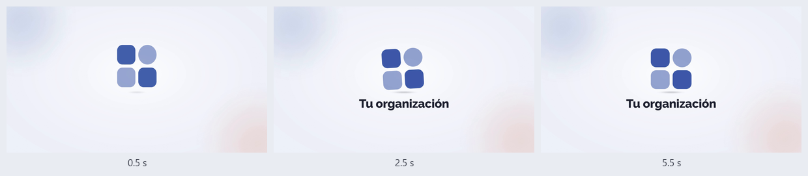

# Estilo del video

Las reglas visuales de la skill, con sus números. Casi todo ya viene puesto en la plantilla: esta guía sirve para saber qué hace cada pieza, qué no conviene tocar y dónde se cambia algo. La regla de fondo: se mide, no se mira. Contraste calculado, cajas medidas en la página y cuadros comparados pixel por pixel.

Todo se diseña en un lienzo de 1920 x 1080. Si el video es de otro tamaño 16:9 (1280 x 720, 3840 x 2160), la escena entera se escala con un solo factor (`capas.mjs`). Las medidas de esta guía son en 1080p.

Cómo habla la voz (tuteo, saludo, conectores, números en palabras) está en `guion.md`.

## 1. Capas y profundidad

El video no es una captura plana: son cuatro capas que se mueven distinto cuando se mueve la cámara (parallax). La más cercana se mueve más.

| Capa | Qué lleva | Cuánto sigue a la cámara | Deriva propia |
|---|---|---|---|
| Fondo | dos manchas grandes y difusas, del `primario` y del `acento` al 20% (de 1000 y 1100 px), encima del degradado fijo del `fondo` | 0.2 | 9 x 6 px, ida y vuelta en 11.3 s |
| Formas suaves | barritas redondeadas de 30 px de ancho en `primario`, `acento` y `linea` | 0.5 | 14 x 9 px en 9.1 s |
| Ventana de la app | la grabación, dentro de un navegador con esquinas de 14 px | 1.0 | 4 x 3 px en 13.7 s |
| Fichas flotantes | tarjetitas sin texto (`fondo2` con un punto `primario` y dos rayas `linea`) y dos puntos de color | 1.35 | 20 x 13 px en 7.9 s |

- Los adornos van a los lados, fuera de la ventana de la app (x de 243 a 1677) y de la franja del título de las entradas. No llevan letras: no se leen ni estorban.
- La deriva es lenta y nunca se detiene: nada en pantalla se congela, ni cuando la voz hace una pausa.
- Los periodos son distintos a propósito (7.9, 9.1, 11.3 y 13.7 s): las capas nunca van al compás y no se nota el ciclo.
- Se cambia en `capas.mjs` → `LAYERS` y `DERIVA`.

## 2. La cámara que respira

- En reposo mira al punto (960, 500), sin acercamiento (1x).
- Se acerca solo cuando una señal lo pide: entre 1.22x y 1.85x, para que el elemento ocupe más o menos la mitad del ancho. Si haría falta menos de 1.22x no se acerca: un acercamiento tan chico parece un error.
- Acercarse dura 1.1 s y la señal espera a que la cámara se asiente; volver a 1x dura de 0.6 a 1.0 s, cuando termina la idea.
- Dos movimientos de cámara encimados se pisan en silencio: `construir` avisa.
- Al acercarse, las fichas del frente desaparecen en 0.25 s y vuelven solo cuando la cámara ya se abrió. Su capa es la que más se desplaza: si se quedaban a la vista mientras la cámara se movía, una cruzaba por el rótulo del capítulo (`medir` lo detectó y ahora revisa cada 0.1 s durante cada movimiento).
- Aunque la cámara esté quieta, la deriva de las capas sigue. Eso es lo que hace que respire.

## 3. Señales

La señal marca lo que la voz está nombrando: recuadro, halo, flecha o acercamiento.

- Entran con fundido (opacidad de 0 a 1) y escala de 0.96 a 1, en 0.42 s. Nada de rebotes ni giros.
- Esquinas redondas y trazo de 3 px en `senal`. El recuadro oscurece lo demás con un velo de `tinta` al 42%.
- Duran al menos 0.7 s. Si duran menos, `construir` las alarga y avisa.
- **Una principal por idea.** Si la voz nombra dos cosas, van dos señales seguidas, no dos a la vez.
- La etiqueta dice qué se señala en **2 a 4 palabras**, en una píldora `primario` con letra `primarioTinta` de 32 px. Así sí: «Tu correo», «Botón Enviar», «Fecha de entrega». Así no: «Aquí tienes que escribir tu correo electrónico». Con más de 4 palabras, `construir` avisa.
- Viven en la zona libre: debajo de los 88 px de arriba (ahí va el rótulo del capítulo), arriba de los 905 px (ahí empiezan los subtítulos) y a 12 px de los lados. Si una se sale, `construir` se detiene: desplaza la pantalla para dejar el elemento más al centro.
- Salen de la caja del elemento medida en la página, nunca de coordenadas a mano, y se marcan después de desplazar la pantalla (detalle en `grabacion.md`).

## 4. El cursor

Se mueve como una mano. Lo que parece azar usa una semilla fija: la misma grabación sale igual cada vez.

- Viaja en curva, no en línea recta: los puntos de control se abren hacia un lado hasta un 14% de la distancia (98 px como mucho).
- Acelera suave y frena largo: 65% curva suave (smoothstep) y 35% frenado cúbico.
- Al llegar se acomoda uno o dos pixeles.
- Antes del clic hace una micro pausa de 80 a 170 ms, y el botón se queda abajo de 55 a 100 ms.
- Cada clic deja una onda suave: un aro de 64 px con trazo de 4 px en `senal`, que crece de 0.25 a 1.45 y se desvanece en 0.55 s.
- La flecha es `fondo2` con borde `tinta` y su sombra.
- El tecleo es irregular: cada letra tarda entre 0.55 y 1.45 veces el ritmo base; espacios y signos, 1.7 veces; la primera letra, 1.4. Al terminar de escribir pulsa Tab, porque en algunas apps el primer clic después de escribir se pierde.
- Se ajusta en `grabacion/escena.mjs` (movimiento y tecleo) y en `construir.mjs` (la onda).

## 5. Subtítulos

- Máximo **2 renglones** (unas 84 letras por subtítulo). Una frase más larga se parte en subtítulos seguidos, por oraciones y, si hace falta, por comas.
- Letra de 44 px con renglón de 54 px y peso 600. Caja con esquinas de 20 px, relleno de 12 x 34 px, a 38 px del borde de abajo, ancho máximo de 1560 px.
- Letra `subtituloTinta` sobre la caja `subtituloFondo` al 90%. `tema.mjs` garantiza 4.5:1 aun con la caja al 80% encima de una imagen blanca o negra: en los cuatro temas el peor caso da de 8.8:1 a 9.7:1.
- Lo que se lee y lo que se dice pueden ser distintos (números, siglas): `sub` y `voz` en `guion.md`.

## 6. Rótulos de capítulo

- Arriba a la izquierda, en (48, 34): píldora de 48 px de alto en `fondo2`, el nombre en `tinta` (Raleway 700 de 27 px) y el número en un círculo `primario` de 32 px con letra `primarioTinta`.
- Entra desde 24 px a la izquierda con fundido, en 0.45 s; sale 18 px a la derecha, en 0.3 s.
- De una a tres palabras: «Entrar», «Pedir ayuda», «Ver cómo va».

## 7. El título de la entrada

Cada audiencia tiene su entrada. En pantalla va **solo el título y, debajo, una línea de «para quién»**:

```
Cómo usar la Mesa de ayuda, paso a paso      Raleway 800 de 104 px, en tinta
Para el equipo de Ventas                     Work Sans 600 de 46 px, en tintaSuave
```

- **Nada de etiquetas diminutas en mayúsculas encima del título** («TUTORIAL · 2026», «GUÍA RÁPIDA»). El título ya dice qué es; la etiqueta solo estorba.
- **Nada de franjas de color al canto de una tarjeta** (un borde grueso de color en un solo lado). Lo que tenga que destacar, que destaque por tamaño, peso o espacio.
- Lo mismo vale para la tarjeta de contacto y para el cierre.

## 8. Tarjeta de contacto

- Sale justo antes del cierre y se ve completa al menos 4 s (`verificar` lo mide).
- Tarjeta `fondo2` con esquinas de 44 px y sombra suave, que sube 36 px con fundido en 0.8 s. A la izquierda, un círculo `primario` de 150 px con un ícono de mensaje en `primarioTinta`.
- El nombre va en Raleway 800 de hasta 72 px, en `tinta`. Debajo, el correo o teléfono, de hasta 60 px: en `primario` si pasa 4.5:1 sobre `fondo2`; si no, en `tinta`. Si el texto es largo, la letra baja (hasta 44 y 40 px) para que quepa.
- La voz dice la frase («Si tienes dudas, escríbele al equipo de soporte»). El correo se lee en la tarjeta y no se dice.

## 9. El cierre

Lo arma `cierre.mjs` desde `proyecto.json` y deja `compositions/cierre.html`, que no se edita a mano. Dura 6 s, es del tamaño del video y `construir` lo monta al final, encima de todo.



| Segundo | Qué pasa |
|---|---|
| 0 a 0.4 | Entra el fondo con fundido y tapa lo que haya debajo. |
| 0.25 a 1.15 | El logo sube, se pasa 16 px, aterriza aplastándose (92% de su alto), rebota 6 px y se asienta. Su sombra crece al aterrizar. |
| 1.05 a 1.95 | El nombre aparece suave: sube 24 px con fundido. |
| 2.0 a 4.1 | El logo se mece desde su base: -3.5°, 2.6°, -1.2° y vuelve a 0°. |
| 4.5 a 6.0 | **Todo quieto.** Aquí resuelve la música. |

- El fondo es `fondo` con una luz suave de `fondo2` al centro y dos manchas, del `primario` al 16% arriba a la izquierda y del `acento` al 18% abajo a la derecha, que derivan lento y paran en 4.5 s.
- Medidas: logo de hasta 300 px de alto o 600 px de ancho; nombre en Raleway 800 de 88 px en `tinta` (baja hasta 60 px si pasa de 20 letras), a 56 px del logo. El conjunto queda centrado.
- Sin logo, sale solo el nombre (entra a los 0.3 s).
- Es seek-safe: una sola línea de tiempo en pausa, todo con `fromTo`, sin animaciones CSS infinitas, sin reloj y sin azar.
- Si cambias el nombre, el logo o los colores, vuelve a correr `node cierre.mjs` (o `node hacer.mjs construir`, que lo corre).

Cómo se comprobó, midiendo sobre cuadros de HyperFrames:

| Qué | Resultado |
|---|---|
| `npx hyperframes check` en los cuatro temas, sin logo, con logo ancho, en vertical (1080 x 1920) y con colores propios | sin hallazgos (lint, runtime, layout, motion y contraste AA) |
| El mismo segundo buscado dos veces y en desorden (0.5, 1.2, 2.5, 4.6 y 5.5 s) | diferencia 0 |
| Quieto al final: 4.5, 4.6 y 5.5 s contra 5.95 s | diferencia 0 |
| Centrado | logo a 0 px; nombre a 2 px o menos; el conjunto, a 1.5 px o menos en vertical |
| Contraste del nombre contra el fondo que tiene atrás | de 14.0:1 a 16.1:1 |
| Contraste del logo de ejemplo contra el fondo a su lado | de 5.3:1 a 7.2:1 |
| Render de los 6 s | 180 cuadros a 30 fps, 6.000 s, H.264 1920 x 1080, menos de 1 MB |

## 10. Música y sonidos

- La música va baja: se normaliza a -16 LUFS, igual que la voz, y suena a 0.15 de volumen: unos 16.5 dB bajo la voz (`MUSICA_BASE` en `capas.mjs`). Mientras habla la voz, el «carve» la baja todavía más en las frecuencias de la voz. `verificar` mide la música sola contra la primera frase del cuerpo y falla si quedan a menos de 10 dB.
- Entra ya sonando y se apaga con el cierre: baja a cero entre el primer segundo del cierre y el final.
- Sonidos solo en momentos clave (un clic que importa, un aviso, algo que salió bien), a 0.6 de volumen. No en cada clic.
- El volumen final del video queda alrededor de -15 LUFS.
- La pista tiene que ser una que la persona tenga permiso de usar.

## 11. Colores

Todos los colores salen de `tema.mjs`. El motor (cuerpo, entradas, tarjeta) y el cierre no tienen colores sueltos.

### Los cuatro temas

| Color | `azul` (el de siempre) | `verde` | `violeta` | `morado` |
|---|---|---|---|---|
| `primario` | `#3E5BA9` | `#2A7466` | `#6B5E9B` | `#7D3A88` |
| `primarioTinta` | `#FFFFFF` | `#FFFFFF` | `#FFFFFF` | `#FFFFFF` |
| `acento` | `#E0795B` coral | `#C9A45C` dorado | `#FF9248` naranja | `#E0679A` rosa |
| `fondo` | `#EDF1F8` | `#EBF3F0` | `#F1EFF7` | `#F6EFF5` |
| `fondo2` | `#FFFFFF` | `#FFFFFF` | `#FFFFFF` | `#FFFFFF` |
| `tinta` | `#1E2230` | `#17272A` | `#211F33` | `#271C2B` |
| `tintaSuave` | `#4F5566` | `#475A57` | `#555170` | `#5C5062` |
| `linea` | `#D3DAE6` | `#D0DED9` | `#DCD8E8` | `#E4D6E2` |
| `senal` | `#D4583A` | `#A8711A` | `#CF5F1A` | `#C94683` |
| `subtituloFondo` | `#161A26` | `#10201D` | `#1C1830` | `#1B1322` |
| `subtituloTinta` | `#FFFFFF` | `#FFFFFF` | `#FFFFFF` | `#FFFFFF` |

### Qué es cada color

| Color | Dónde va |
|---|---|
| `primario` | rótulos de capítulo, etiquetas de las señales, formas del fondo, el ícono de la tarjeta |
| `primarioTinta` | letra encima del `primario` |
| `acento` | formas suaves del fondo y detalles. No es color de letra |
| `fondo` | el escenario detrás de la ventana, las entradas y el cierre |
| `fondo2` | superficies encima del fondo: fichas, tarjeta de contacto, rótulos |
| `tinta` | letra principal, sobre `fondo` o `fondo2` |
| `tintaSuave` | letra secundaria (la línea de «para quién», la dirección de la ventana), sobre `fondo` o `fondo2` |
| `linea` | bordes finos y separadores. Es adorno, no letra |
| `senal` | trazo de las señales: halo, recuadro, flecha y onda del clic. No es color de letra |
| `subtituloFondo` | caja de los subtítulos |
| `subtituloTinta` | letra de los subtítulos |

Para letra se usan solo los pares que se miden:

| Letra | Sobre | Mínimo | azul | verde | violeta | morado |
|---|---|---|---|---|---|---|
| `tinta` | `fondo` | 4.5:1 | 13.97 | 13.68 | 14.09 | 14.44 |
| `tinta` | `fondo2` | 4.5:1 | 15.83 | 15.44 | 16.05 | 16.31 |
| `tintaSuave` | `fondo` | 4.5:1 | 6.57 | 6.49 | 6.59 | 6.69 |
| `tintaSuave` | `fondo2` | 4.5:1 | 7.44 | 7.32 | 7.51 | 7.56 |
| `primarioTinta` | `primario` | 4.5:1 | 6.41 | 5.54 | 5.68 | 7.41 |
| `subtituloTinta` | `subtituloFondo` al 80% sobre blanco | 4.5:1 | 9.14 | 8.83 | 9.12 | 9.67 |
| trazo `senal` | blanco (la app) | 3:1 | 4.00 | 4.17 | 3.96 | 4.48 |
| trazo `senal` | `fondo` | 3:1 | 3.53 | 3.69 | 3.47 | 3.96 |

En los cuatro temas el `primario` también se lee como letra sobre `fondo` (de 4.9:1 a 6.6:1), pero con colores propios eso no se garantiza: para letra, usa la tabla.

### Cambiar los colores

Con un tema, en `proyecto.json`:

```json
"tema": "verde",
"colores": null
```

Con los colores de tu marca, en hex. Lo demás (letra encima del primario, fichas, letra suave, línea, señal y caja del subtítulo) se calcula solo y se mide:

```json
"tema": "azul",
"colores": { "primario": "#0B7285", "acento": "#F59F00", "fondo": "#F8F9FA", "tinta": "#212529" }
```

- Puedes dar solo uno (por ejemplo, solo `primario`): los demás salen del tema.
- También puedes fijar cualquiera de los once colores a mano (por ejemplo `"senal": "#B4232A"`); también se mide.
- Si un par no se lee, nada se arma: el motor se detiene, dice cuál par falla, cuánto da y qué color usar. Por ejemplo:

```
proyecto.json → colores no se lee:
  · tinta #999999 sobre fondo #FFFFFF da 2.85:1 y necesita 4.5:1 (letra principal sobre el fondo). Prueba tinta #757575 (da 4.61:1).
```

- Un fondo gris medio (ni claro ni oscuro) no deja que la señal se vea a la vez sobre la app y sobre el fondo; el motor también lo dice. Usa un fondo claro o uno muy oscuro.
- Para revisar los colores sin armar nada: `node tema.prueba.mjs` (30 pruebas: los cuatro temas par por par, colores propios y 400 combinaciones al azar con semilla fija).

Si escribes código del motor: los colores se piden con `tema(proyecto)`; para transparencias, `conAlfa(t.primario, 0.2)`; para mezclas, `mezcla(a, b, 0.1)`; para medir, `contraste(a, b)`. Las variables CSS salen de `variablesCss(t)` (`--primario`, `--primario-tinta`, ...).

## 12. El logo

- SVG (mejor) o PNG, dentro de `marca/`, con su ruta en `proyecto.json` → `marca.logo`. Sin logo (`null`), el cierre sale solo con el nombre.
- SVG con `viewBox` justo al dibujo, sin margen: así queda centrado de verdad. El cierre le agrega su propio aire (4% por lado) al meterlo, porque un dibujo que toca el borde de la imagen cambia su borde según por dónde se llegó a un segundo.
- Lo que en el SVG vaya en `currentColor` toma el `primario` del tema. Así funciona el logo de ejemplo (`marca/logo.svg`), una forma neutral que se cambia por la tuya.
- PNG: con fondo transparente y un poco de margen.
- Que su color más fuerte pase 3:1 contra el `fondo`.
- El nombre, corto: hasta unas 30 letras. Con más de 40, `cierre.mjs` avisa.

## 13. Letras

- Raleway (títulos, rótulos y el nombre del cierre) y Work Sans (texto y subtítulos), las dos variables, en `assets/fonts/` con su licencia OFL (`OFL-Raleway.txt`, `OFL-WorkSans.txt`). Traen acentos, ñ, ¿ y ¡.
- El cierre lleva Raleway adentro del archivo: no depende de rutas.

## 14. Lo aprendido midiendo

- Un degradado que se apaga en línea recta y termina de golpe deja un anillo visible en el video comprimido (banda de Mach). Los degradados del cierre se apagan en curva. Para una luz al centro va mejor (1 - t)²: la curva smoothstep deja el centro plano y se lee como un disco.
- En video de 8 bits, un degradado muy suave sale en escalones de un nivel de luz. Es normal; lo que molesta es el anillo de arriba.
- Una forma con degradado que se mueve: solo desplazamiento, sin cambiar de escala. Con escala, la GPU pinta el degradado con 1/255 de diferencia entre dos búsquedas del mismo segundo.
- Un logo cuyo dibujo toca el borde de la imagen cambia ese borde (5 pixeles, hasta 5/255) según por dónde se llegó al segundo. Por eso el cierre le agrega aire.
- Con la GPU del equipo, a veces un solo pixel del fondo cambia 1/255 entre dos capturas del mismo segundo; con SwiftShader (`--no-browser-gpu`) sale idéntico. No se ve y queda muy por debajo del ruido de la compresión. Para renders idénticos byte por byte, HyperFrames tiene `render --docker`.
- En el MP4, dos cuadros quietos difieren hasta 6/255 en unos cuantos pixeles: es la compresión H.264, no la composición (los cuadros de origen son idénticos).
